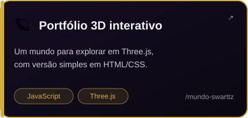
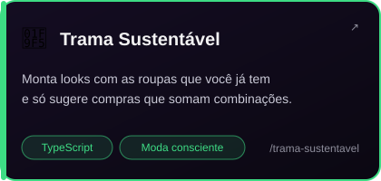
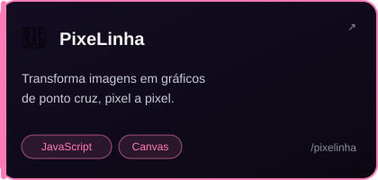
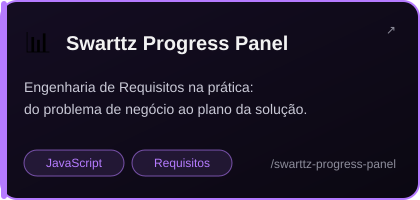

 

 

<h2 align="center">⌁ quem sou eu, em um terminal ⌁</h2>

  

 

<h2 align="center">⌁ a jornada até aqui ⌁</h2>

  

 

<h2 align="center">⌁ caixa de ferramentas ⌁</h2>

<b>🎨 Interfaces</b>

<table>
<tr>
<td align="center" width="96"> <b>HTML</b></td>
<td align="center" width="96"> <b>CSS</b></td>
<td align="center" width="96"> <b>JavaScript</b></td>
<td align="center" width="96"> <b>TypeScript</b></td>
<td align="center" width="96"> <b>React</b></td>
<td align="center" width="96"> <b>Next.js</b></td>
<td align="center" width="96"> <b>Tailwind</b></td>
<td align="center" width="96"> <b>Three.js</b></td>
</tr>
</table>

<b>⚙️ Back-end</b>

<table>
<tr>
<td align="center" width="96"> <b>Python</b></td>
<td align="center" width="96"> <b>Node.js</b></td>
<td align="center" width="96"> <b>NestJS</b></td>
<td align="center" width="96"> <b>PostgreSQL</b></td>
</tr>
</table>

<b>🧰 Dia a dia</b>

<table>
<tr>
<td align="center" width="96"> <b>Git</b></td>
<td align="center" width="96"> <b>GitHub</b></td>
<td align="center" width="96"> <b>VS Code</b></td>
<td align="center" width="96"> <b>Figma</b></td>
</tr>
</table>

<b>🤖 Estudando</b>

  

 

<h2 align="center">⌁ coisas que eu construí ⌁</h2>

  
  
   
  
  
   
  ↳ e mais experimentos em <a href="https://github.com/GabriellaCunhaa?tab=repositories">todos os repositórios</a>

 

<h2 align="center">⌁ o código em números ⌁</h2>

  
  
   
  

 

<h2 align="center">⌁ bora conversar? ⌁</h2>

Se você quer trocar ideia sobre front-end, Python, IA, ou só dizer <b>oi</b>, 
minha caixa de entrada está sempre aberta. ✦

 

<picture>
  <source media="(prefers-color-scheme: dark)" srcset="https://raw.githubusercontent.com/GabriellaCunhaa/Cobrinha_no_Perfil/output/github-snake-dark.svg" />
  
</picture>

✦ feito com café, curiosidade e muitos <code>console.log</code> ✦

